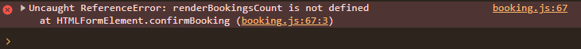
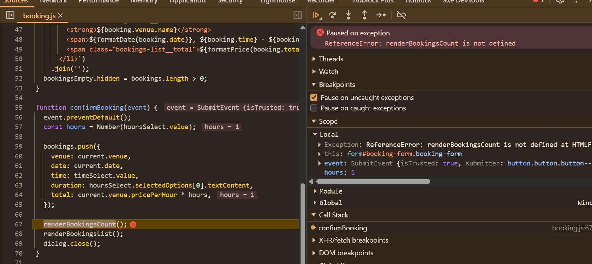
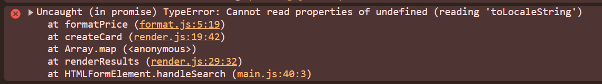
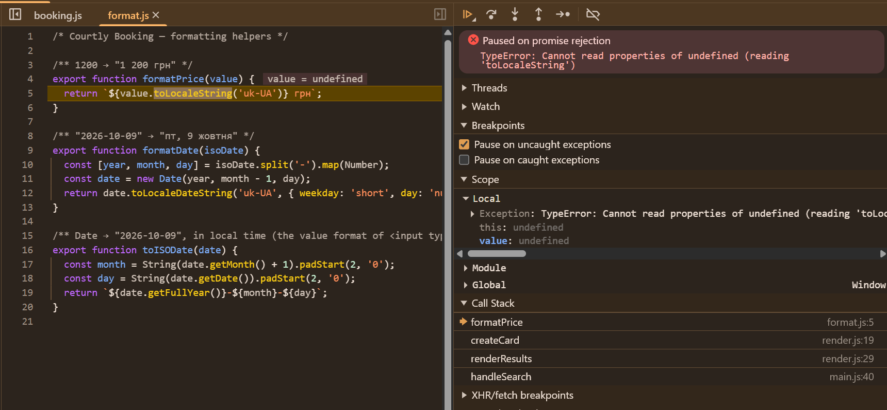
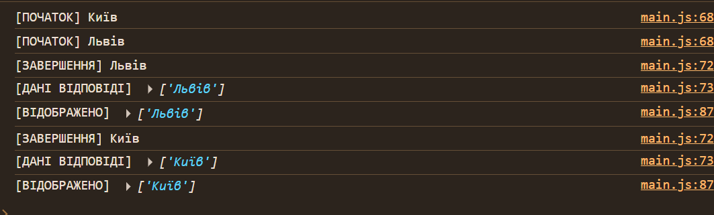
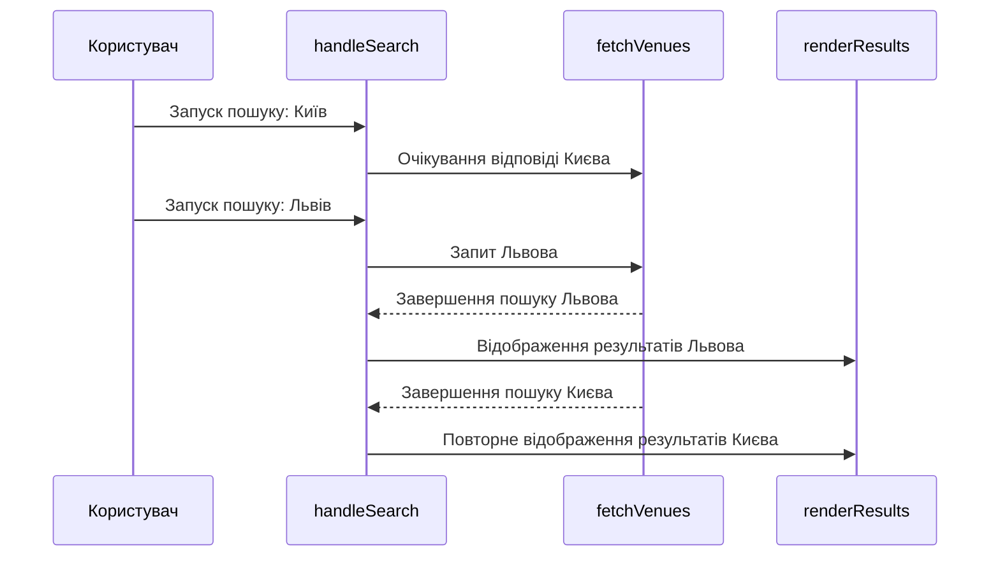
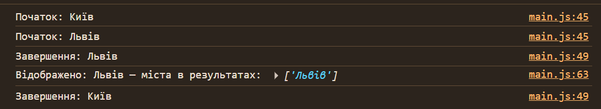
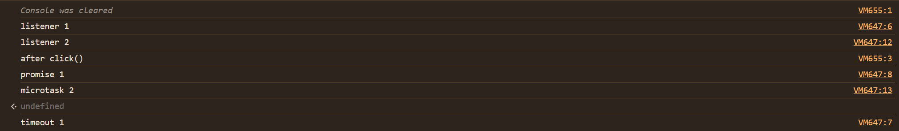

# Звіт про налагодження: Courtly Booking

- **Репозиторій:** https://github.com/illiadavydiuk7/WebDev
- **Опублікована сторінка:** https://webdev-courtly-booking-starter.vercel.app/

---

## 1. Висновки дослідницьких завдань і результати досліджень

### 1.1. Console і типи помилок

`ReferenceError` означає звернення до невизначеного імені, `TypeError` — некоректну операцію над значенням, а `SyntaxError` під час розбору не дає виконати скрипт; необроблена runtime-помилка зупиняє поточний шлях виконання, але не всю сторінку. У дослідженні помилок `JSON.parse('{')` відрізнено від синтаксичної помилки самого скрипту: перша виникає під час виконання виклику й має стек викликів, друга — до запуску коду. `Uncaught (in promise)` означає, що відхилення Promise не було оброблено; рівні й фільтри Console допомагають звузити журнал, а **Preserve log** зберігає його між навігаціями. Не всі дефекти породжують повідомлення, тож відсутність помилки в Console не доводить правильність інтерфейсу.

### 1.2. Stack Trace і панель Sources

Stack Trace читають від місця виявлення помилки до викликів, що привели до нього; назва функції, файл, рядок і колонка допомагають перейти до коду. У сценаріях звіту, наприклад, стек `formatPrice → createCard → renderResults → handleSearch` привів від помилки форматування до неправильного поля у записі Royal Court — місце помилки не було першопричиною. **Sources** дає змогу зупинити виконання на breakpoint, переглянути Call Stack, Scope і Watch; асинхронні кадри пов'язують callback із місцем його планування. Breakpoints можна ставити на рядок, умовно, як logpoint, на зміну DOM, подію або виняток.

### 1.3. DOM у DevTools

DOM у **Elements** показує поточний стан сторінки після JavaScript, на відміну від початкового HTML і View page source. У перевірці B2 нові картки замінювали старі вузли: `getEventListeners($0)` показав обробник на кнопці до пошуку й відсутність обробника на новій кнопці після нього; обробник прив'язаний до вузла, не до селектора. `querySelector` повертає перший збіг або `null`, `querySelectorAll` — статичний NodeList, а `getElementById` — елемент за ID або `null`; `$0`, `$$()` і `monitorEvents()` пришвидшують інспекцію в Console. Вкладка **Event Listeners** і `getEventListeners($0)` доповнюють одна одну; делегування подій на спільному предку може обробляти й динамічно створені дочірні вузли.

### 1.4. Event Loop

Синхронний код виконується у Call Stack; таймери, мережеві запити й події обслуговуються браузерними Web APIs, а їхні callbacks потрапляють до черги задач. Після завершення поточної задачі Event Loop спорожнює чергу мікрозадач (Promise `.then()`, продовження після `await`, `queueMicrotask`) перед наступною задачею; callback `setTimeout(..., 0)` не виконується негайно, а стає доступним після мінімальної затримки та поточних задач. У фактичному експерименті C.2 фізичне натискання дало порядок `listener 1`, `promise 1`, `listener 2`, `microtask 2`, `timeout 1`, тоді як `btn.click()` виконав обидва синхронні обробники до `after click()`, а потім мікрозадачі й таймер.

### 1.5. AI-assisted debugging

AI найкраще допомагав швидко сформувати кілька гіпотез і знайти ймовірний кодовий шлях: наприклад, невідповідність назви функції, поля даних, обробників кнопок або селектора меню. Відповіді залишалися гіпотезами, які перевіряли через Stack Trace, DOM, фактичні дані, Event Listeners і порядок завершення асинхронних запитів. Така перевірка важлива, щоб не прийняти припущення за причину й не маскувати її `try/catch`, optional chaining, значенням за замовчуванням чи довільним `setTimeout`; приклад розбіжності між гіпотезою про race condition і фактичною причиною B1 наведено в підсумку.

---

## 2. Назва та версія AI-агента, модель, дата роботи

- **Агент:** GitHub Copilot
- **Модель:** gpt-6-luna
- **Дата роботи:** 15.10.2026

---

## 3. Сценарії A і B

### Сценарій A

#### A1. Кнопка підтвердження бронювання

**Очікувана поведінка:** після підтвердження бронювання діалог закривається, лічильник збільшується, запис з'являється у списку.

**Фактична поведінка:** виникає `ReferenceError`, подальше оновлення інтерфейсу не виконується.

**Кроки відтворення:**

1. Відкрити DevTools → Console.
2. Натиснути «Забронювати».
3. Заповнити форму та підтвердити бронювання.

**Console до виправлення:**




**Stack Trace:** `confirmBooking` — `booking.js:67`.

**Scope:**

- `this` — форма `#booking-form`
- `event` — `SubmitEvent`
- `hours` — `1`

Помилка виникає через виклик невизначеної функції.

**Гіпотези:**

| #      | Гіпотеза                             | Перевірка                                                                        | Результат    |
| ------ | ------------------------------------ | -------------------------------------------------------------------------------- | ------------ |
| Власна | Неправильна назва функції            | Порівняння оголошення `renderBookingCount()` із викликом `renderBookingsCount()` | Підтверджено |
| AI № 1 | Невідповідність назви функції        | Те саме порівняння коду; AI підтвердив власне припущення                         | Підтверджено |
| AI № 2 | Браузер завантажив іншу версію файлу | Порівняння `booking.js` у Sources із локальним файлом                            | Відкинуто    |

**Запит до AI:**

> booking.js:67 Uncaught ReferenceError: renderBookingsCount is not defined
> at HTMLFormElement.confirmBooking (booking.js:67:3)
>
> Проаналізуй цю помилку як senior JavaScript debugger. Назви 2–3 можливі першопричини, спираючись лише на наведені Console, Stack Trace і код. Для кожної запропонуй перевірку в DevTools, яка її підтвердить або відкине. Код не змінюй.

**Відповідь AI:** найімовірніше, назви функції під час оголошення та виклику не збігаються; альтернативна причина — інша версія файлу в браузері.

**Виправлення:** `renderBookingsCount()` замінено на `renderBookingCount()`.

**Коміт:** https://github.com/illiadavydiuk7/WebDev/commit/8e3a0430024cae6929e9af31c284879ed11e8388

**Перевірка після виправлення:** повторно підтверджено бронювання.

- Console не містить цієї помилки.
- Діалог закривається.
- Лічильник збільшується.
- Запис з'являється у списку.

---

#### A2. Ціна майданчика

**1. Очікувана та фактична поведінка**

- **Очікувана:** після пошуку майданчиків система відображає всі результати, що відповідають фільтрам, разом із ціною за годину.
- **Фактична:** під час формування карток виникає `TypeError`, через який результати пошуку не відображаються належним чином.

**2. Кроки відтворення**

1. Відкрити застосунок Courtly Booking.
2. Відкрити інструменти розробника браузера та перейти до вкладки Console.
3. Вибрати місто **Львів** і вид спорту **«Теніс»**.
4. Виконати пошук майданчиків.
5. Перевірити повідомлення про помилку в консолі.

**3. Повідомлення в Console**



**4. Аналіз Stack Trace**


- Помилка виникає у функції `formatPrice()` файлу `format.js` під час виклику `toLocaleString()`.
- У стеку викликів також є `createCard()` і `renderResults()` із файлу `render.js`, які відповідають за формування карток результатів.
- У локальному файлі `data/venues.json` виявлено неправильну назву властивості ціни в об'єкта **Royal Court**: `pricePerhour` замість `pricePerHour`.
- Код очікує властивість `pricePerHour`, тому функція отримує `undefined`.

**5. Гіпотези та способи перевірки**

| #      | Гіпотеза                                                   | Перевірка                                                                           | Результат                                                        |
| ------ | ---------------------------------------------------------- | ----------------------------------------------------------------------------------- | ---------------------------------------------------------------- |
| Власна | Неправильна назва властивості ціни в JSON                  | Перевірка записів, де `pricePerHour === undefined`                                  | Підтверджено: знайдено Royal Court із властивістю `pricePerhour` |
| AI № 1 | Назва властивості не відповідає очікуваній структурі даних | Порівняння поля в `venues.json` із використанням `venue.pricePerHour` у `render.js` | Підтверджено                                                     |
| AI № 2 | Браузер завантажив іншу версію даних                       | Порівняння локального `venues.json` із відповіддю у вкладці Network                 | Відкинуто                                                        |

**6. Запит до AI та відповідь**

- **Запит:** проаналізуй помилку `TypeError: Cannot read properties of undefined (reading 'toLocaleString')`, яка виникає у функції `formatPrice()` під час рендерингу карток майданчиків. Запропонуй можливі причини та способи перевірки в DevTools, не змінюючи код.
- **Відповідь AI:** найімовірніша причина — неправильна назва властивості ціни в одному із записів JSON. Також варто перевірити фактично завантажені дані у Network та структуру об'єктів на breakpoint у `render.js`. Значення `this: undefined` не є причиною цієї помилки.

**7. Виправлення та перевірка**

- У файлі `data/venues.json` замінено `pricePerhour` на `pricePerHour` у записі Royal Court.
- Повторено пошук, перевірено відображення карток і ціни майданчиків.
- Переконано, що помилка більше не з'являється в Console.

**Коміт:** https://github.com/illiadavydiuk7/WebDev/commit/275b935502bcdd261508771a9ce4c1cb4a0b784b8

**8. Результат**

Під час аналізу Stack Trace та перевірки даних виявлено невідповідність назви властивості між JSON-файлом і кодом рендерингу. Причину локалізовано в `data/venues.json`. Для виправлення достатньо узгодити назву поля з очікуваною структурою даних.

---

### Сценарій B

#### B1. Неправильна кількість результатів пошуку

**1. Очікувана та фактична поведінка**

- **Очікувана:** після завершення пошуку статус має показувати фактичну кількість знайдених майданчиків.
- **Фактична:** статус показує «Знайдено: 2», хоча контейнер `#results` містить лише одну картку. Помилок у Console немає.

**2. Перевірка елементів у Elements**

Перевірено елементи `#status`, `#results` та форму `#search-form`. У Console виявлено два обробники події `submit`, прив'язані до форми:

```js
getEventListeners(document.querySelector('#search-form')).submit;
// масив із двох обробників
```

**3. Перевірка DOM у Console**

```js
document.querySelector('#status')?.textContent;
// 'Знайдено: 2'

document.querySelector('#results')?.children.length;
// 1
```

Зафіксовано розбіжність між текстом статусу та кількістю елементів у контейнері результатів.

**4. Виявлення причини**

- У `main.js` пошук виконується асинхронною функцією `handleSearch()`, яка очікує завершення `fetchVenues()`, а потім оновлює картки через `renderResults()`.
- Окремий обробник `submit` одразу читає `results.children.length` і формує текст статусу.
- Через це він може використати кількість карток, що залишилася від попереднього пошуку.
- Після завершення рендерингу статус повторно не оновлюється.

**5. Гіпотези та способи перевірки**

| #      | Гіпотеза                                                             | Результат                                                                               |
| ------ | -------------------------------------------------------------------- | --------------------------------------------------------------------------------------- |
| Власна | Статус підраховує картки до завершення асинхронного пошуку           | Підтверджено: два обробники `submit` і розбіжність між статусом та DOM                  |
| AI № 1 | Обробник статусу виконується раніше за завершення `handleSearch()`   | Підтверджено: після перенесення оновлення статусу в `handleSearch()` розбіжність зникає |
| AI № 2 | Кілька пошуків завершуються не в тому порядку, в якому були запущені | Не підтверджено: швидкі повторні пошуки розбіжності не відтворили                       |
| AI № 3 | Помилка рендерингу перешкоджає оновленню DOM                         | Не підтверджено: у Console не було помилок                                              |

**6. Аналіз за допомогою AI та виправлення**

- AI вказав на ймовірну причину: статус оновлюється окремим обробником до завершення асинхронного пошуку.
- **Виправлення:** перенести оновлення статусу всередину `handleSearch()` — після виклику `renderResults(results, found)` — і видалити окремий обробник `submit`, який рахує картки.

**Коміт:** https://github.com/illiadavydiuk7/WebDev/commit/d442b2b1f08566b3d19d1d542f1937d44ebdc9b0

**7. Перевірка після виправлення**

- Повторено пошук із різними фільтрами. Кількість карток у `#results` відповідає значенню в `#status`.
- Пошук без результатів коректно показує повідомлення «Нічого не знайдено».
- Помилок у Console не виявлено.

**8. Чому перевірка в DevTools є сильнішим доказом**

HTML-файл показує початкову структуру сторінки, але не відображає всіх змін, які відбуваються під час виконання JavaScript. У DevTools можна перевірити актуальний DOM, зареєстровані обробники подій, значення елементів і послідовність виконання коду. Тому перевірка в браузері дає змогу підтвердити фактичну поведінку застосунку, а не лише припускати її за вихідним кодом.

---

#### B2. Кнопка бронювання не працювала після пошуку

**1. Очікувана та фактична поведінка**

- **Очікувана:** після пошуку користувач може натиснути кнопку бронювання будь-якого знайденого майданчика та відкрити форму бронювання.
- **Фактична:** після пошуку кнопки бронювання перестають реагувати на натискання. Помилок у Console не спостерігається.

**2. Кроки відтворення**

1. Відкрити сторінку Courtly Booking.
2. Перевірити роботу кнопки бронювання на початковій картці.
3. Виконати пошук майданчиків.
4. Натиснути кнопку бронювання на одній із нових карток.
5. Перевірити обробники подій у DevTools → Elements і Console.

**3. Console до виправлення**

```js
// До пошуку, на кнопці з Elements:
getEventListeners($0).click;
// масив з одним обробником події click

// Після пошуку, на новій кнопці:
getEventListeners($0).click;
// undefined
```

Відсутність обробника на новій кнопці.

**4. Стан DOM і гіпотези**

| #   | Гіпотеза                                                                                                  | Результат                                                                 |
| --- | --------------------------------------------------------------------------------------------------------- | ------------------------------------------------------------------------- |
| 1   | Після пошуку `renderResults()` замінює HTML карток, тому нові кнопки не мають обробників старих елементів | Підтверджено: порівняння `getEventListeners($0).click` до та після пошуку |
| 2   | Функція `venues.find(...)` повертає `undefined`                                                           | Не підтверджено: основною причиною була відсутність обробника             |

Перевірка гіпотези 2 полягала у перевірці `button.dataset.id` та результату пошуку відповідного об'єкта `venue`.

**5. Prompt і стисла відповідь AI**

- **Prompt:** «маємо ось таку проблему: після пошуку коли натискаю кнопку бронювання нічого не відбувається». Проаналізуй цю помилку як senior JavaScript debugger. Назви 2–3 можливі першопричини, спираючись лише на наведені Console, Stack Trace і код. Для кожної запропонуй перевірку в DevTools, яка її підтвердить або відкине. Код не змінюй.
- **Відповідь AI:** `renderResults()` створює нові кнопки, які не успадковують обробники попередніх елементів. Потрібно викликати `bindBookButtons()` після кожного рендерингу результатів.

**6. Виправлення**

У `main.js` після оновлення результатів і масиву `venues` додано виклик:

```js
const found = await fetchVenues(readFilters());
renderResults(results, found);
venues = found;
bindBookButtons();
```

**Коміт:** https://github.com/illiadavydiuk7/WebDev/commit/9f272013aaaed911b0d4d7ba7697614d1a37d846

**7. Console і поведінка після виправлення**

Після виправлення кнопки бронювання отримують обробники події `click` після кожного пошуку. Повторна перевірка показує наявність обробника на нових кнопках, а натискання відкриває форму бронювання вибраного майданчика.

---

#### B3. Не відображалось меню в мобільному форматі

**1. Очікувана та фактична поведінка**

- **Очікувана:** натискання кнопки меню відкриває мобільну навігацію, змінює `aria-expanded` на `true` і додає клас `is-open` до навігації.
- **Фактична:** натискання кнопки-гамбургера не відкриває меню.

**2. Кроки відтворення**

1. Відкрити сторінку Courtly Booking.
2. Увімкнути мобільний режим у DevTools.
3. Натиснути кнопку-гамбургер.
4. Перевірити стан `aria-expanded` і клас навігації.
5. Перевірити селектор кнопки в `main.js`.

**3. Console до виправлення**

```js
document.querySelector('.site-header button')?.className;
// Селектор знаходив першу кнопку в шапці — «Мої бронювання», а не кнопку меню

document.getElementById('site-nav')?.className;
// до відкриття меню: 'site-nav'
```

**4. Стан DOM і гіпотези**

| #   | Гіпотеза                                    | Перевірка                                                                                                                 | Результат                                                                                                                                                            |
| --- | ------------------------------------------- | ------------------------------------------------------------------------------------------------------------------------- | -------------------------------------------------------------------------------------------------------------------------------------------------------------------- |
| 1   | Обробник прив'язаний до неправильної кнопки | У `index.html` кнопка `.bookings-toggle` розташована перед `.menu-toggle`, а селектор `.site-header button` вибирає першу | Підтверджено                                                                                                                                                         |
| 2   | CSS приховує меню навіть після натискання   | Перегляд класу `#site-nav` і значень `display`, `visibility`, `opacity` через `getComputedStyle()`                        | Відкинуто: після виправлення селектора меню отримує `is-open`, а стилі показують `display: block`, `visibility: visible`, `opacity: 1`, меню в межах видимої області |

**5. Prompt і стисла відповідь AI**

- **Prompt:** «не відображається меню в мобільному режимі». Проаналізуй цю помилку як senior JavaScript debugger. Назви 2–3 можливі першопричини, спираючись лише на наведені Console, Stack Trace і код. Для кожної запропонуй перевірку в DevTools, яка її підтвердить або відкине. Код не змінюй.
- **Відповідь AI:** селектор вибирає першу кнопку в шапці, якою є «Мої бронювання». Потрібно використовувати селектор `.menu-toggle`, щоб обробник кліку був прив'язаний до кнопки меню.

**6. Виправлення**

У `main.js` замінено селектор:

```js
const menuToggle = document.querySelector('.menu-toggle');
```

**Коміт:** https://github.com/illiadavydiuk7/WebDev/commit/4d15c7f601c797097b5eed4eb117674c8e6551df

**Рекомендована назва коміту:** `fix(B): target mobile menu toggle button`

**7. Console і поведінка після виправлення**

Після виправлення селектора натискання кнопки меню змінює `aria-expanded` і додає клас `is-open` до `#site-nav`. Обчислені стилі показують, що меню видиме. Візуальна перевірка підтвердила коректне відкриття мобільної навігації.

---

## 4. Сценарій C. Виявлення та виправлення race condition

Результати розділено на до й після виправлення. Прогнози для C.2, які не були записані до запуску експерименту, позначено як **реконструйовані**, а не зафіксовані заздалегідь.

### C.1. Дослідження асинхронного пошуку

#### 1. Виявлена проблема

Під час дослідження функції `handleSearch()` перевірено поведінку застосунку під час швидкого перемикання між містами. У початковій версії після завершення `fetchVenues()` результати одразу передавалися до `renderResults()`, незалежно від того, чи не було запущено новий пошук.

Це створювало ризик race condition: застаріла відповідь могла перезаписати результати останнього пошуку.

#### 2. Фактичний порядок логів до виправлення

Під час тестування запущено пошук для Києва, а до його завершення — пошук для Львова. Діагностичні повідомлення мали такий порядок:



Пошук для Львова завершився раніше, але пізніше завершення пошуку для Києва могло повторно оновити інтерфейс застарілими даними.

#### 3. Пояснення причини

Функція `handleSearch()` є асинхронною. Під час `await fetchVenues(...)` вона призупиняється, а браузер може обробляти інші події та виконувати інші запити. Кожен запуск `handleSearch()` продовжує виконання незалежно від інших запусків.

У початковому коді не було перевірки, чи залишається запит актуальним після завершення очікування, тому будь-яка відповідь могла викликати `renderResults()` і змінити інтерфейс.

Пізня відповідь сама по собі не є помилкою. Проблема виникає тоді, коли застаріла відповідь змінює результати, які вже відповідають новішому пошуку.

#### 4. Схема виконання до виправлення

Схема відтворює послідовність подій з логів (реконструкція за підписами вузлів):



Ця схема описує сценарій, у якому застаріла відповідь справді доходить до рендерингу.

#### 5. Prompt для AI

Запущено пошук для Києва, а до завершення цього запиту — пошук для Львова. У Console видно, що запит Львова завершився першим і його результати відобразилися, а запит Києва завершився пізніше.

> Проаналізуй цю проблему як senior JavaScript debugger. На основі наведених логів і коду визнач, чи є тут потенційна проблема з асинхронністю. Запропонуй перевірки в DevTools, які допоможуть підтвердити або спростувати ризик перезапису актуальних результатів застарілим запитом. Код не змінюй.

#### 6. Стисла відповідь AI

AI визначив потенційну race condition: оскільки в початковому `handleSearch()` після `await fetchVenues(...)` немає перевірки актуальності запиту, пізніша відповідь Києва може перезаписати результати Львова. Для перевірки запропоновано зіставити діагностичні логи та поставити breakpoint перед `renderResults()`, щоб порівняти місто поточного запиту з містами отриманих результатів.

#### 7. Виправлення та перевірка

Додано лічильник пошуків `searchId`. Кожен новий пошук збільшує його значення, а після `await` перевіряється, чи не було запущено новіший запит.


```js
let searchId = 0;

async function handleSearch(event) {
  event.preventDefault();

  const currentSearchId = ++searchId;
  const filters = readFilters();

  status.textContent = 'Шукаємо…';
  results.setAttribute('aria-busy', 'true');

  const found = await fetchVenues(filters);

  if (currentSearchId !== searchId) return;

  renderResults(results, found);
  venues = found;
  bindBookButtons();

  results.setAttribute('aria-busy', 'false');
  status.textContent = found.length ? `Знайдено: ${found.length}` : 'Нічого не знайдено';
}
```

Після виправлення повторно запущено пошук для Києва, а потім Львова. Запит Києва завершився пізніше, але застаріла відповідь не оновлює інтерфейс, оскільки перевірка зупиняє її виконання перед `renderResults()`.

#### 8. Коміт

- **Назва коміту:** `fix(C): ignore stale venue search responses`
- **Посилання:** https://github.com/illiadavydiuk7/WebDev/commit/aedfcef8a1a3ee752646085f3175d6ec8591a19f

### C.2. Експеримент із порядком виконання JavaScript

#### 1. Код експерименту

```js
const btn = document.createElement('button');
btn.textContent = 'Event Loop demo';
document.body.prepend(btn);

btn.addEventListener('click', () => {
  console.log('listener 1');
  setTimeout(() => console.log('timeout 1'), 0);
  Promise.resolve().then(() => console.log('promise 1'));
});

btn.addEventListener('click', () => {
  console.log('listener 2');
  queueMicrotask(() => console.log('microtask 2'));
});
```

#### 2. Випадок 1 — фізичне натискання кнопки

**Мій прогноз.** Обидва обробники виконаються синхронно, а після них — мікрозадачі та таймер. Очікуваний порядок: `listener 1`, `listener 2`, `promise 1`, `microtask 2`, `timeout 1`.

**Прогноз AI .** Обидва обробники виконуються в межах одного циклу обробки події; Promise та `queueMicrotask` виконуються до таймера. Точний порядок двох мікрозадач залежить від порядку їх постановки в чергу.

**Фактичний результат у Chrome:**

```text
listener 1
promise 1
listener 2
microtask 2
timeout 1
```

Отриманий порядок відрізнявся від очікуваного: `promise 1` з'явився до `listener 2`. Це зафіксований результат експерименту; він не відповідає типовому очікуванню, що обидва обробники одного поширення події завершаться до виконання мікрозадач.

#### 3. Випадок 2 — програмний виклик `btn.click()`

У Console виконано:

```js
btn.click();
console.log('after click()');
```

**Мій прогноз.** Виклик `btn.click()` синхронно запускає обробники, тому їхні синхронні повідомлення з'являться до `after click()`. Promise, `queueMicrotask` і таймер виконаються пізніше.

**Прогноз AI (реконструйований).** Спочатку обидва синхронні обробники, потім `after click()`, далі мікрозадачі та таймер.

**Фактичний результат у Chrome:**

```text
listener 1
listener 2
after click()
promise 1
microtask 2
timeout 1
```


Цього разу результат відповідав прогнозу: обидва синхронні обробники виконалися до наступного `console.log()`, а асинхронні колбеки — після нього.

#### 4. Висновок

Експеримент показав, що `btn.click()` синхронно запускає обробники події, тоді як Promise та `queueMicrotask` ставлять колбеки в чергу мікрозадач, а `setTimeout` — у чергу таймерів. У другому випадку це чітко видно за порядком логів.

---

## 5. Таблиця регресійної перевірки

Перевірку виконано 15.10.2026 у браузері на локально запущеному проєкті. Перевірено ширини 1280, 1024, 1023 і 390 px. Стан «до виправлень» узято з відтворень і доказів, уже описаних у сценаріях A–C та історії комітів; де попередній прогін не був зафіксований, це зазначено окремо. Стан «після» — результат повторної перевірки поточного робочого дерева.

| Поведінка з ТЗ                          | До виправлень                                                                                                                                                                                                                    | Після                                                                                                                                                                                                                                                                                                                       |
| --------------------------------------- | -------------------------------------------------------------------------------------------------------------------------------------------------------------------------------------------------------------------------------- | --------------------------------------------------------------------------------------------------------------------------------------------------------------------------------------------------------------------------------------------------------------------------------------------------------------------------- |
| **3.1 Header і mobile menu**            | На мобільній ширині кнопка гамбургера не відкривала навігацію: `.site-header button` вибирав кнопку «Мої бронювання», а не `.menu-toggle` (сценарій B3). Попередній окремий результат для ширини 1024 px у звіті не зафіксовано. | На 1280 і 1024 px показана навігація, кнопка меню прихована; на 1023 і 390 px навігація прихована до відкриття, кнопка меню видима. На 390 px кнопка відкриває й закриває меню, `aria-expanded` переходить `false → true → false` узгоджено з класом `is-open`. Кнопка «Мої бронювання» відкриває діалог.                   |
| **3.2 Початковий стан**                 | Попередній окремий браузерний прогін початкового стану у звіті не зафіксовано. За кодом задумано шість популярних майданчиків, відсортованих за рейтингом.                                                                       | Після завантаження — 6 карток із рейтингами 4.9, 4.8, 4.7, 4.7, 4.6, 4.5; статус «Популярні майданчики: 6», `aria-busy="false"`, дата встановлена на сьогодні. Помилок і попереджень Console під час перевірки не було.                                                                                                     |
| **3.3 Пошук і фільтри**                 | Окремий обробник статусу міг показати кількість карток від попереднього пошуку (B1). Фільтрація містом і спортом була реалізована; проте за швидких повторних пошуків застаріла відповідь могла перезаписати новішу (C.1).       | Під час запиту статус показує «Шукаємо…», список має `aria-busy="true"`. Перевірено: усі фільтри — 12 результатів; лише Київ — 3; лише теніс — 4; Львів + теніс — 2; Дніпро + теніс — 0 і «Нічого не знайдено». Кількість у статусі збігається з картками, порядок — за спаданням рейтингу. Зміна дати не фільтрує каталог. |
| **3.3 Останній із паралельних пошуків** | Захисту від застарілих відповідей не було: швидший пошук для Львова міг бути перезаписаний пізнішою відповіддю Києва (C.1).                                                                                                      | Запущено пошук Києва, а до його завершення — Львова. Після завершення обох запитів відображено три майданчики Львова; пізня відповідь Києва інтерфейс не змінила. Перевірку виконано після виправлення в коміті.                                                                                                            |
| **3.4 Картки та кнопки бронювання**     | Після пошуку нові кнопки не мали обробників і не відкривали діалог (B2). У Royal Court була неправильна назва поля ціни, що спричиняла помилку під час рендерингу результату з цим майданчиком (A2).                             | Кожна з шести початкових карток відкриває бронювання саме свого майданчика. Кнопка результату після пошуку також працює. Перевірено відображення ціни, зокрема Royal Court — «від 1 200 грн/год».                                                                                                                           |
| **3.5 Діалог бронювання**               | Підтвердження додавало запис у масив, але потім зупинялося з `ReferenceError: renderBookingsCount is not defined`; список не оновлювався і діалог не закривався (A1).                                                            | Перевірено майданчик, дату, 14 варіантів часу з 08:00 до 21:00, початкову ціну 450 грн і негайне оновлення до 1 350 грн для трьох годин. Підтвердження закриває діалог; «Скасувати» закриває його та повертає фокус на кнопку-відкривач.                                                                                    |
| **3.6 Мої бронювання**                  | Через помилку під час підтвердження лічильник, список і закриття діалогу не оновлювались (A1).                                                                                                                                   | Порожній список показує «Бронювань ще немає», лічильник дорівнює 0. Після підтвердження однієї броні лічильник дорівнює 1, у списку є правильний майданчик, дата, час, тривалість і сума; після перезавантаження список і лічильник порожні. E                                                                              |
| **3.7 Console**                         | Зафіксовано `ReferenceError` під час підтвердження бронювання та `TypeError` під час рендерингу Royal Court (A1–A2).                                                                                                             | Під час перевірених сценаріїв Console не містила помилок чи попереджень від застосунку.                                                                                                                                                                                                                                     |

**Дефекти, знайдені, але не виправлені:** підтверджених дефектів поведінки не залишилося.

---

## 6. Підсумок

AI-агент реально скоротив час debugging у випадках, де вдалося швидко звузити пошук до конкретного місця в коді: невідповідність назви `renderBookingsCount()` / `renderBookingCount()` у A1, неправильна назва поля ціни в даних Royal Court у A2, відсутність обробників на замінених після пошуку кнопках у B2 та надто загальний селектор кнопки меню у B3. У B1 агент також вказав правильний напрям — статус оновлювався до завершення асинхронного пошуку; це допомогло сформулювати мінімальне виправлення.

Водночас відповідь агента була гіпотезою, а не доказом. У DevTools довелося звіряти Stack Trace і назви функцій, перевіряти реально завантажені дані, кількість обробників на нових DOM-елементах, стан статусу та карток після запиту, а також фактичний порядок завершення пошуків. Саме такі перевірки відділяли підтверджену причину від альтернатив: наприклад, у B1 можливе неправильне завершення конкурентних запитів було відкинуто для того відтворення, тоді як дві події `submit` і читання старої кількості карток підтвердили першопричину.

**Приклад відповіді, яка могла б замаскувати першопричину:** у B1 серед гіпотез агента було припущення, що неправильний статус спричинений пошуками, які завершуються не в порядку запуску. Якби зосередитися лише на цьому й додати захист від застарілих запитів, це не усунуло б фактичну причину зафіксованої розбіжності: окремий обробник `submit` рахував `results.children.length` до завершення `handleSearch()` і показував кількість попередніх карток. Перевірка двох обробників форми та порівняння статусу з DOM у DevTools показали, що потрібно перенести оновлення статусу після рендерингу результатів. Це приклад неперевіреної AI-гіпотези, а не виправлення, яке агент фактично рекомендував застосувати.

Отже, агент був найкориснішим для швидкого формування й ранжування гіпотез та пошуку ймовірного місця дефекту; DevTools були потрібні, щоб перевірити їх на фактичному DOM, даних і порядку виконання та не виправляти симптом замість першопричини. Оскільки не в кожному випадку перша гіпотеза агента підтверджувалася, додатковий сценарій «попросити агента одразу виправити помилку лише в одному файлі» не проводився: спершу потрібно було підтвердити, який саме файл і рядок є джерелом дефекту.

Перевірено вимоги §3 у десктопному та мобільному режимах, включно з початковим станом, фільтрами, порожньою видачею, паралельними запитами, бронюванням, лічильником і Console. Усі перевірені сценарії пройшли. Перед здачею потрібно вручну перевірити закриття обох діалогів клавішею Escape.
