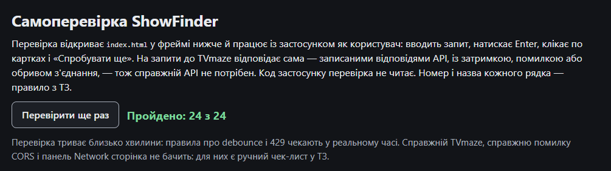
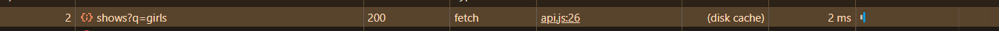
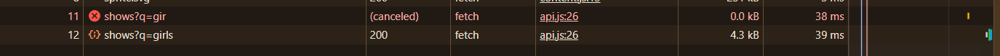
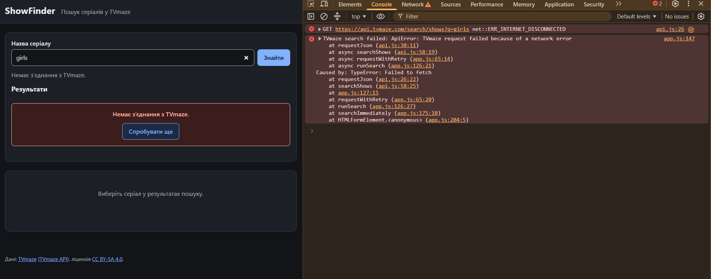
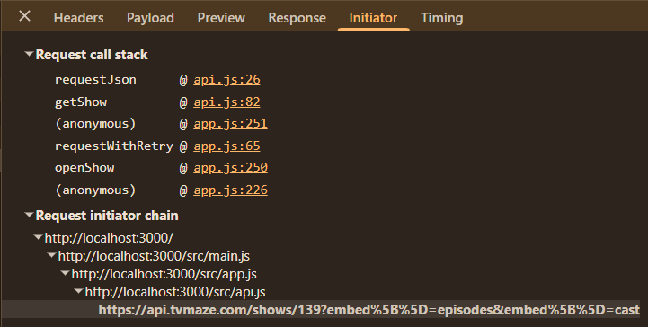
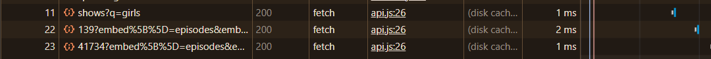
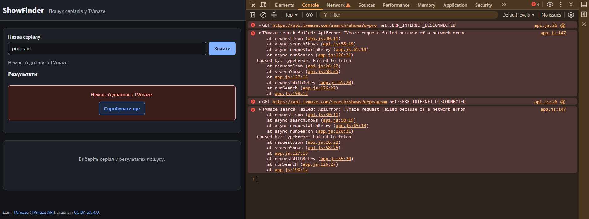

# Звіт: ЛР-11. AI-агент для інтеграції REST API

## 0. Посилання

- GitHub repository: [https://github.com/illiadavydiuk7/WebDev/](https://github.com/illiadavydiuk7/WebDev)
- GitHub Pages або Vercel: [https://<username>.github.io/<repository>/ або https://<project>.vercel.app/](https://webdev-showfinder-starter.vercel.app/)
---
- Конспект API: [API.md](API.md)
- Файл правил агента: [AGENTS.md](AGENTS.md)

---

## 1. Агент

- Назва й версія агента: Git Hub Copilot
- Модель: gpt-6-luna
- Дата роботи: 17.10.2026

---

## 2. Таблиця експериментів

| # | Що досліджено | Мій аналіз | Фактичний результат (Console і Network) | Пояснення (якщо не збіглося) |
|:-:|---|---|---|:-:|
| 1 | `fetch` і статус 404 | Проміс не відхилиться через статус 404. Очікується false 404 і об'єкт із повідомленням про помилку. | GET ... 404; false 404 `{name: 'Not Found', message: '', code: 0, status: 404}` | – |
| 2 | Тіло відповіді читається один раз | Очікується назва серіалу Game of Thrones, помилка TypeError при повторному читанні та SyntaxError для HTML. | перше: Game of Thrones; вдруге: TypeError; далі HTML: `SyntaxError Unexpected token '<', "<!doctype "... is not valid JSON` | – |
| 3 | `forEach`, `for...of`, `Promise.all` | forEach не очікує завершення запитів; for…of виконує їх послідовно, а Promise.all запускає паралельно. | Console: forEach: 0, через 2 с: 3, for…of: 140 мс, Promise.all: 150 мс. Network: 3 запити завершилися паралельно раніше, ще 6 — пізніше, також паралельно. | – |
| 4 | `return` і `return await` у `try` | Внутрішній catch не спрацює; зовнішній перехопить помилку TypeError. | `net::ERR_NAME_NOT_RESOLVED`; поза load: TypeError | – |
| 5 | `Promise.all` і `Promise.allSettled` | Promise.all відхилить загальний проміс через помилку одного запиту. Promise.allSettled поверне результат кожного запиту. | all: TypeError; allSettled: `['fulfilled', 'rejected', 'fulfilled']` | – |
| 6 | `AbortController` | Якщо скасувати запит до отримання відповіді, виникне AbortError. Якщо скасувати після отримання заголовків, читання тіла відповіді може завершитися помилкою. | до відповіді: AbortError; після відповіді: 200; json(): AbortError | – |
| 7 | Заголовки відповіді | content-type і cache-control будуть доступні; date може бути недоступним через CORS. | `application/json; charset=UTF-8`; `public, max-age=3600`; null; `['cache-control', 'content-type']` | – |
| 8 | HTTP-кеш (три однакові запити) | Перший запит завантажить відповідь із мережі, повторний може використати кеш, а `cache: 'no-store'` має обійти HTTP-кеш. | Перший запит був звичайним, другий кешований, третій некешований | – |
| 9 | Переадресація 301 (`/lookup/shows`) | status покаже кінцевий статус 200, redirected — true, а url — кінцеву адресу. | 200; true; `'https://api.tvmaze.com/shows/82'`; Game of Thrones | – |
| 10 | Рядок запиту (`URLSearchParams`) | У першій адресі q дорівнює Law, а Order сприймається як окремий параметр. У другій адресі весь текст передається як значення q. | `Law` `['q', ' Order']`; `Law & Order` `?q=Law+%26+Order` | – |
| 11 | Два домени TVmaze | API поверне 200. Запит до сайту може завершитися помилкою CORS, якщо сервер не дозволяє читати відповідь із поточного origin. | api: 200; www: TypeError `Failed to fetch`; Console: `No 'Access-Control-Allow-Origin' header is present.` | – |
| 12 | Preflight (`Content-Type` / `Accept`) | Content-Type: application/json спричинить preflight OPTIONS, а Accept: application/json дозволить звичайний запит. | Content-Type: TypeError `Failed to fetch`; Accept: 200. Console повідомляє про невдалу CORS-перевірку preflight. | – |
| 13 | `mode: 'no-cors'` | Браузер поверне непрозору відповідь (opaque), статус 0, ok: false; прочитати тіло відповіді не вдасться. | opaque; 0; false; `""` | – |
---

## 3. Самоперевірка

- Результат `check.html` на опублікованій сторінці: **Пройдено: 24 з 24**

- Що `check.html` не бачить (і чому це перевіряє Network):

---

## 4. Чек-лист Network (ТЗ, §6)

Перевірки N1–N6 — за переліком у ТЗ. Для кожної — знімок екрана.

# Перевірки з ТЗ і знімки екрана

| № | Перевірка (з ТЗ) | Результат | Знімок екрана |
|:-:|---|---|---|
| N1 | Запит пошуку `girls` | Запит до TVmaze повертає статус `200 OK`. Параметр `q=girls` передається в URL. У відповіді отримано масив результатів. Перевірено заголовки `cache-control` і `access-control-allow-origin`. |  |
| N2 | Повільна мережа — Slow 4G | Під час пошуку відображається «Завантаження…». Після введення `girls` попередній запит `gir` скасовується, а на сторінці відображаються результати для `girls`. | |
| N3 | Відсутність мережі | Під час відключення мережі запит завершується помилкою. У Console зафіксовано `ERR_INTERNET_DISCONNECTED` і помилку мережевого запиту. Перевірити, що сторінка показує «Немає з'єднання з TVmaze.», а після відновлення мережі кнопка «Спробувати ще» працює. |  |
| N4 | Initiator | Запит деталей серіалу ініціюється кодом застосунку. У вкладці Initiator можна побачити файл і рядок JavaScript, що спричинили запит. |  |
| N5 | Кешування | Повторне відкриття раніше завантаженого серіалу не створює нового запиту до API завдяки кешу деталей у застосунку. Для повторного пошуку `girls` перевірено колонку Size та поведінку HTTP-кешу браузера. |  |
| N6 | Console | Пошук, відкриття сторінки серіалу та обробка відсутності мережі перевірені. Потрібно переконатися, що немає необроблених помилок JavaScript (`Uncaught`). Повідомлення про невдале завантаження ресурсу під час навмисного блокування мережі є очікуваним. |  |

---

## 5. Аудит і виправлення по challenge

Для кожного challenge — окремий блок.

### Challenge 1

- **Чернетка AI (коміт):** [e155b8d](https://github.com/illiadavydiuk7/WebDev/commit/e155b8d)
- **Порушені правила ТЗ** (правило — доказ у Network — чому): не виявлено; пошук і стани інтерфейсу перевірено, `check.html` пройдено (24/24).
- **Виправлення (коміт `Challenge 1: fixes`):** не виконувалися — чернетку залишено без змін, окремого коміту виправлень немає.
- **Чи чернетка пройшла свій блок без змін:** так
- **Файли, які агент змінив поза блоком, і чи відкочені (`git restore`):** поза блоком нічого не змінено; захищені файли `check.html`, `check/` та `offline.html` не змінювалися.

### Challenge 2

- **Чернетка AI (коміт):** [6ac522f](https://github.com/illiadavydiuk7/WebDev/commit/6ac522f)
- **Порушені правила ТЗ** (правило — доказ у Network — чому): не виявлено; завантаження деталей, епізодів і акторів та кешування перевірено.
- **Виправлення (коміт `Challenge 2: fixes`):** не виконувалися — чернетку залишено без змін, окремого коміту виправлень немає.
- **Чи чернетка пройшла свій блок без змін:** так
- **Файли, які агент змінив поза блоком, і чи відкочені (`git restore`):** поза блоком нічого не змінено; захищені файли `check.html`, `check/` та `offline.html` не змінювалися.

### Challenge 3

- **Чернетка AI (коміт):** [cd93e59](https://github.com/illiadavydiuk7/WebDev/commit/cd93e59)
- **Порушені правила ТЗ** (правило — доказ у Network — чому): не виявлено; мережеві помилки, повторний запит і стани інтерфейсу перевірено.
- **Виправлення (коміт `Challenge 3: fixes`):** не виконувалися — чернетку залишено без змін, окремого коміту виправлень немає.
- **Чи чернетка пройшла свій блок без змін:** так
- **Файли, які агент змінив поза блоком, і чи відкочені (`git restore`):** поза блоком нічого не змінено; у Challenge 3 змінювалися лише `src/api.js` і `src/app.js`. Захищені файли `check.html`, `check/` та `offline.html` не змінювалися.

---

## 6. Підсумок виконаної роботи

- **Challenge 1:** реалізовано пошук серіалів через TVmaze: обрізання й кодування запиту, обробку результатів, індикатор завантаження, порожній стан і помилки, скасування застарілих запитів. Чернетку не довелося виправляти.
- **Challenge 2:** реалізовано завантаження серіалу з епізодами й акторами одним запитом, відображення деталей і кешування за ID; передбачено завантаження, помилки та скасування застарілих запитів. Чернетку не довелося виправляти.
- **Challenge 3:** додано класифікацію помилок API та зрозумілі повідомлення, повтор запиту один раз після HTTP 429 із затримкою 3 секунди, а також обробку повторної спроби для деталей і пошуку. Чернетку не довелося виправляти.
- **Файл правил `AGENTS.md`:** зафіксовано правила інтеграції з TVmaze, обробки помилок, кешування, скасування запитів і перелік файлів, які не можна змінювати. Файл додано окремим комітом до Challenge 3; у коміті Challenge 3 його не змінювали.
- **Чи агент змінював файли, які змінювати не можна:** ні. `check.html`, каталог `check/` і `offline.html` не змінювалися.
- **Загальний висновок:** у межах лабораторної роботи створено ShowFinder — вебзастосунок для пошуку серіалів і перегляду їхніх деталей на основі TVmaze REST API. Реалізація охоплює пошук із коректним формуванням URL, завантаження повної інформації про серіал разом з епізодами й акторами, кешування деталей, скасування застарілих запитів, відображення станів завантаження та помилок і повтор запиту після відповіді HTTP 429. Під час роботи досліджено поведінку `fetch`, HTTP-кешу, CORS, `AbortController` і паралельних запитів; результати перевірено в браузері та зафіксовано в таблиці експериментів і перевірках Network. Усі три AI-чернетки прийнято без додаткових виправлень, а захищені файли проєкту не змінювалися. Автоматична перевірка `check.html` пройдена: 24 із 24; перевірки Network N1–N6 задокументовано зі знімками екрана. Отже, поставлені завдання виконано, а застосунок обробляє як звичайний сценарій роботи з API, так і типові мережеві помилки.

---

## 7. Коміти

| Коміт                   | Посилання |
| ----------------------- | --------- |
| starter-проєкт без змін | [a15253e](https://github.com/illiadavydiuk7/WebDev/commit/a15253e) |
| API notes               | [7b31a51](https://github.com/illiadavydiuk7/WebDev/commit/7b31a51) |
| Challenge 1: AI draft   | [e155b8d](https://github.com/illiadavydiuk7/WebDev/commit/e155b8d) |
| Challenge 1: fixes      | Не було |
| Challenge 2: AI draft   | [6ac522f](https://github.com/illiadavydiuk7/WebDev/commit/6ac522f) |
| Challenge 2: fixes      | Не було |
| Agent rules             | [91ddbad](https://github.com/illiadavydiuk7/WebDev/commit/91ddbad) |
| Challenge 3: AI draft   | [cd93e59](https://github.com/illiadavydiuk7/WebDev/commit/cd93e59) |
| Challenge 3: fixes      | Не було |
